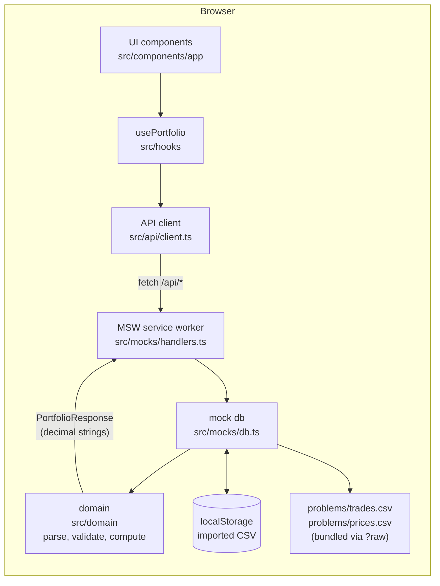

# Cyclone portfolio analytics

Single-page app that shows a crypto portfolio (BTC, ETH, SOL, CKB, DOGE on Binance and Coinbase) from a `trades.csv` file and a `prices.csv` snapshot. It computes holdings, weighted-average cost, realized and unrealized P&L, fees and allocation, and lets the user import and re-import trade files.

- Task statement: [PROBLEM.md](PROBLEM.md) (source: `problems/assessment.pdf`)
- Open client questions and the decisions taken: [QUESTIONS.md](QUESTIONS.md)
- AI-agent workflow log: [AI_WORKFLOW.md](AI_WORKFLOW.md)
- Detailed docs: [docs/architecture.md](docs/architecture.md), [docs/calculation.md](docs/calculation.md), [docs/deployment.md](docs/deployment.md)
- Instructions for coding agents: [AGENTS.md](AGENTS.md)

## Deployment URL

https://cyclone.8bu.dev

## Local setup

Requirements: Node.js and [pnpm](https://pnpm.io/).

```sh
pnpm install
pnpm dev
```

`pnpm dev` starts Vite. Open the printed local URL. The mock backend starts in the browser together with the app; nothing else needs to run.

### Environment variables

There are none. The app reads no environment variables, has no `.env` file, and needs no API keys or secrets. No secret is stored in the repository. Deployment credentials (`wrangler login` or a `CLOUDFLARE_API_TOKEN`) live outside the repo; see [docs/deployment.md](docs/deployment.md).

## Commands

| Command | What it does |
|---|---|
| `pnpm dev` | Vite dev server |
| `pnpm test` | Runs all tests once (`vitest run`; files `src/**/*.test.ts`) |
| `pnpm test:watch` | Vitest in watch mode |
| `pnpm typecheck` | `tsc -b` (type-checks app and tooling projects) |
| `pnpm lint` | `eslint .` |
| `pnpm format` | `prettier --write "**/*.{ts,tsx}"` |
| `pnpm build` | `tsc -b && vite build`, output in `dist/` |
| `pnpm preview` | `vite preview` of `dist/` |
| `pnpm preview:worker` | `pnpm build && wrangler dev`: serves `dist/` the way Cloudflare Workers static assets will |
| `pnpm run deploy` | `pnpm build && wrangler deploy` (use `run`: bare `pnpm deploy` is a built-in pnpm command) |

## Architecture and data flow

Four layers. Money math exists only in the domain layer; the UI renders what the API returns.



1. On start, `main.tsx` starts the MSW service worker, then renders the app.
2. `usePortfolio` calls `GET /api/portfolio`. The handler returns trades, the price snapshot and the computed portfolio in one payload.
3. Import posts the raw CSV text. The domain validates the whole file; on any issue the API answers `422` with the issue list and the stored data is unchanged.
4. Components format decimal strings for display. They never recompute.

Details: [docs/architecture.md](docs/architecture.md).

## Portfolio calculation

Weighted-average cost per asset, pooled across both exchanges, processing trades in timestamp order:

- BUY: `cost += quantity x price + fee`.
- SELL: `net proceeds = quantity x price - fee`; `cost removed = cost x quantity / held quantity`; `realized = net proceeds - cost removed`. The average cost does not change.
- Full close (quantity sold equals quantity held): cost basis and quantity become exactly 0.
- Valuation: `value = quantity x price`; `unrealized = value - cost basis`; `total = realized + unrealized`; `allocation = value / portfolio value`.
- `total fees` = sum of the fee of every BUY and SELL.

Formulas, validation rules, issue codes, a worked example and the golden numbers for the sample data: [docs/calculation.md](docs/calculation.md).

## Precision and rounding

- All money math uses `decimal.js` through one isolated constructor in `src/domain/decimal.ts`: `Decimal.clone({ precision: 40, rounding: ROUND_HALF_UP })`. It never touches the global `Decimal` config.
- Amounts cross the API boundary as decimal strings (`"105507.74"`), never as JS numbers. Strings are serialized with `toFixed()`, so no exponent notation appears.
- On a partial SELL, the cost removed is `cost x quantity / held`, rounded to 30 decimal places. This keeps sums of realized P&L exact within 40 significant digits. On a full close the whole cost basis is removed exactly, so a closed position ends at exactly 0 and a later BUY starts from scratch.
- Rounding for display only, half up, in `src/lib/format.ts`: USD to 2 dp, percent to 2 dp, unit prices to 2 dp (>= 1) or up to 8 dp (< 1), quantities up to 8 dp. Values are converted to JS numbers only for chart geometry (`toChartNumber`).

## Sample data: load and reset

- The sample files are `problems/trades.csv` (200 trades) and `problems/prices.csv` (one price per asset, one `as_of`). They are bundled into the app with Vite `?raw` imports.
- On first load, or after a reset, the app shows the sample data (badge "Sample data").
- **Import trades.csv** (header button) opens a dialog to choose a CSV file or paste CSV text. A valid file replaces the current dataset (badge "Imported data"). An invalid file changes nothing and shows the issues.
- **Reset sample data** (header button, with a confirmation dialog) discards the imported dataset and restores the bundled sample.
- **Download sample trades.csv** downloads the current dataset as `trades.csv` (`GET /api/trades.csv`). On a fresh load that is the bundled sample, and it is a valid file to re-import.

## Assumptions, limitations, trade-offs

- Cost basis is pooled per asset across Binance and Coinbase (decision recorded in [QUESTIONS.md](QUESTIONS.md)). A SELL on one exchange can consume units bought on the other.
- The backend is MSW running as a service worker in the browser. It is a simulated backend: requests never leave the browser, and there is no shared server state. The imported dataset is stored per browser in `localStorage` (key `cyclone.trades.v1`). If `localStorage` is unavailable or full, the dataset stays in memory for the session.
- Prices come only from the bundled `prices.csv` snapshot. There is no live market data and no way to import prices in the UI. The valuation time is the latest `as_of` in that file.
- Trades are ordered by timestamp. Trades with equal timestamps keep file order (stable sort). Timestamps must be ISO-8601 with a timezone (`Z` or `+hh:mm`) and are normalized to UTC.
- The SELL-versus-holdings check runs in that time order, across both exchanges. A SELL listed before its BUY in the file is accepted if the BUY is earlier in time.
- A header-only CSV is valid and gives an empty dataset (the app shows its "No trades loaded" state).
- Import is capped at 2 MB (`413` above that) and reports at most 200 issues; the dialog lists the first 50.
- A symbol with no price is excluded from portfolio value, unrealized P&L, total P&L and allocation. Its cost basis and realized P&L still count, and a warning lists the missing symbols.
- Only the exchanges Binance and Coinbase and the symbols BTC, ETH, SOL, CKB, DOGE are accepted.
- The transactions table paginates (25 rows per page); it is not virtualized.
- Single currency (USD). No tax lots, no auth.

## Future improvements

- Real backend (for example Cloudflare Workers with D1) replacing MSW; the API contract in `src/domain/types.ts` and the table in [docs/architecture.md](docs/architecture.md) would stay.
- Price API instead of a static snapshot.
- Tax-lot accounting (FIFO, LIFO, specific lot) as alternatives to weighted-average cost.
- Multi-currency support.
- Virtualized transactions table for large files.
- End-to-end browser tests.

## Project structure

```
.
├── AGENTS.md                 instructions for coding agents
├── AI_WORKFLOW.md            AI-agent workflow log
├── PROBLEM.md                task summary
├── QUESTIONS.md              open client questions and decisions
├── README.md
├── docs/                     architecture, calculation, deployment
├── problems/                 read-only source material: assessment.pdf, trades.csv, prices.csv
├── public/mockServiceWorker.js   MSW service worker (must ship in dist)
├── wrangler.jsonc            Cloudflare Workers static assets config
├── vite.config.ts            Vite and Vitest config
└── src/
    ├── main.tsx              starts the MSW worker, then renders the app
    ├── App.tsx               page composition and state switching
    ├── domain/               pure logic: csv, import, prices, portfolio, decimal, types (+ tests)
    ├── mocks/                MSW backend: handlers, db, browser worker
    ├── api/client.ts         typed fetch client
    ├── hooks/use-portfolio.ts   data hook (load, import, reset)
    ├── components/app/       app components (header, tables, charts, dialogs, states)
    ├── components/ui/        shadcn/ui components
    └── lib/                  format.ts (display formatting), utils.ts
```
